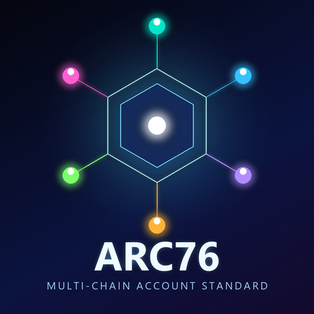

# @arc76/bitcoincash

<p align="center"></p>

Deterministic [ARC76](https://github.com/algorandfoundation/ARCs/blob/main/ARCs/arc-0076.md)
account derivation for **Bitcoin Cash**.

## Usage

```
npm i @arc76/bitcoincash --save
```

```ts
import * as bitcoin from "bitcoinjs-lib";
import { encode } from "cashaddrjs";
import { getAccount, getEmailAccount } from "@arc76/bitcoincash";

const account = await getAccount(password); // slot 0, an ECPair keypair
const hash160 = bitcoin.crypto.hash160(Buffer.from(account.publicKey));
const address = encode("bitcoincash", "P2PKH", hash160); // "bitcoincash:q..."
const wif = account.toWIF();

const emailAccount = await getEmailAccount(email, password);
```

`getAccount`/`getEmailAccount` return an `ecpair` `ECPairInterface` (the same secp256k1 key
type as `@arc76/bitcoin` — only the address format differs). Use `cashaddrjs`'s `encode(...)`
over the hash160 of the public key for the **CashAddr** address (`bitcoincash:q...`), the
standard Bitcoin Cash address format since the network-wide 2018 CashAddr migration — not
Bitcoin's Base58Check or bech32. `.toWIF()` gives the private key in the same WIF format
Bitcoin uses (WIF doesn't depend on the CashAddr/Base58Check distinction).

Please use a password of at least 50 characters for real accounts — the account's security is
entirely the password's security.

> ⚠️ **Same-curve chains share the literal same private key.** `@arc76/bitcoin`,
> `@arc76/bitcoincash`, and `@arc76/ethereum` derive the **identical secp256k1 private key**
> from the same password/email/slot — leaking the key on one of those chains leaks it on all of
> them. Use a different password (or `slot`) per chain if you need isolation.
